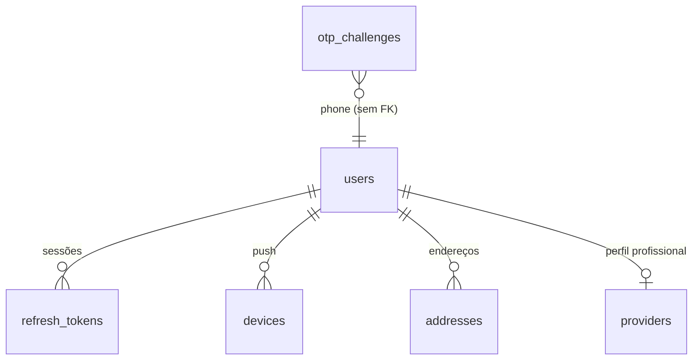
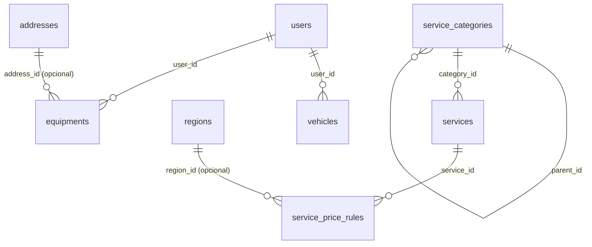
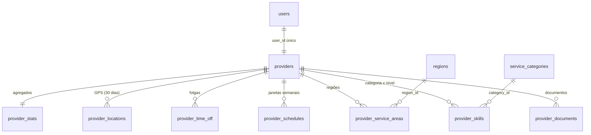
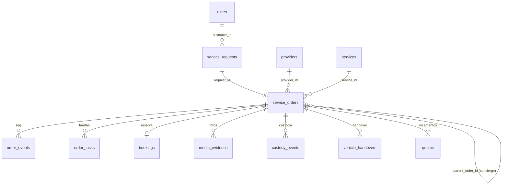
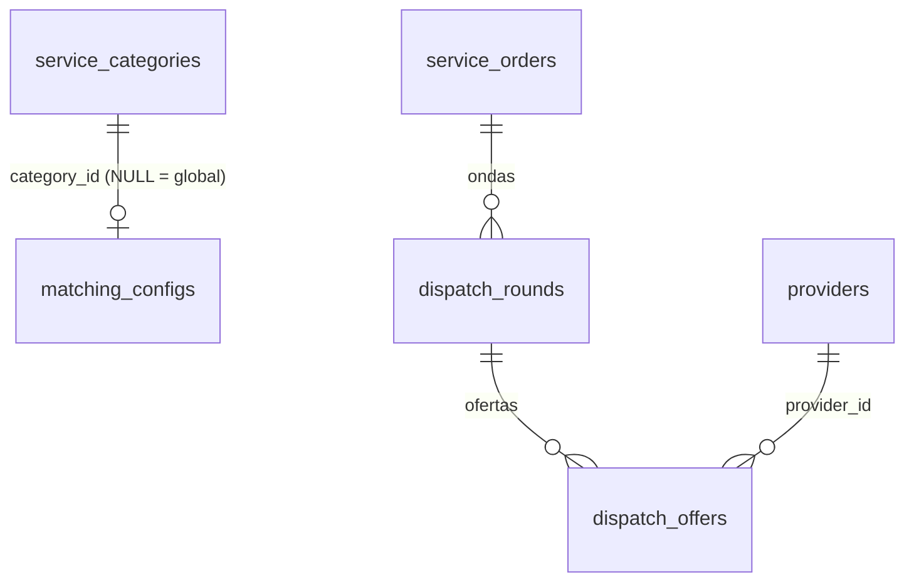
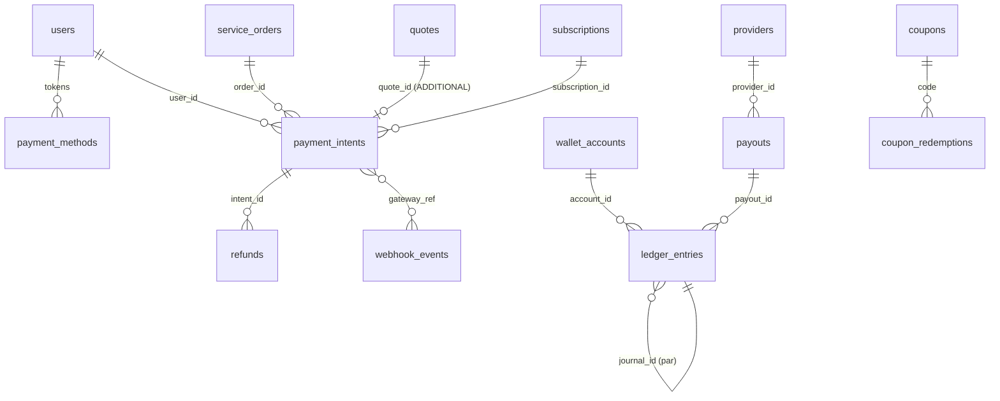
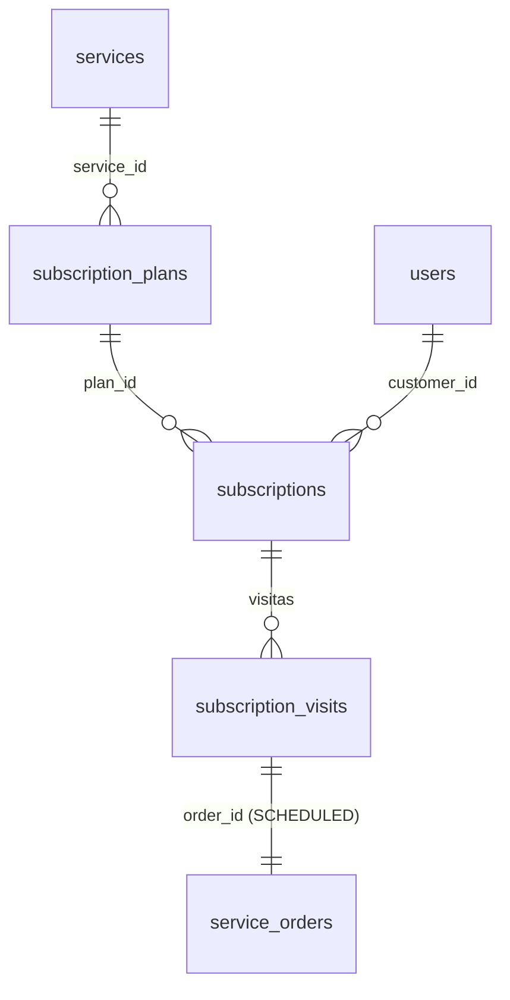
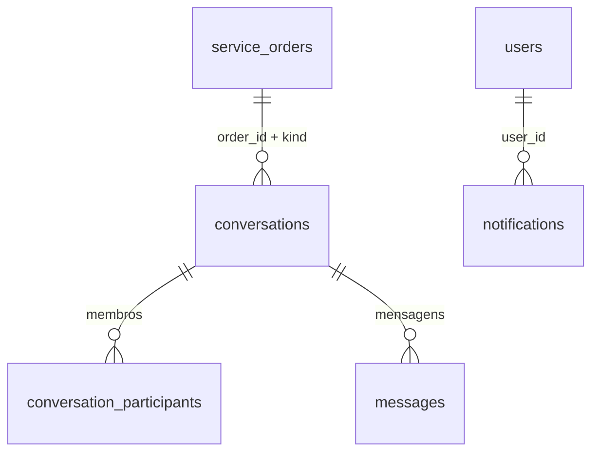
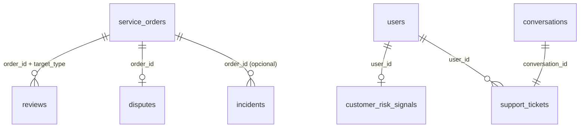
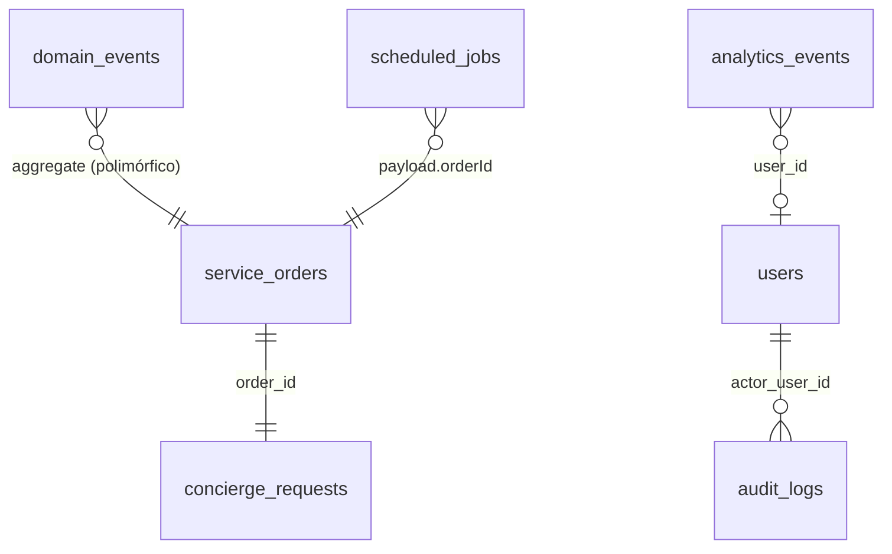

# 07 — Schema do Banco de Dados

Derivado de `apps/api/src/db/schema/*.ts` (Drizzle) e do DDL gerado `apps/api/drizzle/0000_typical_kate_bishop.sql`. 63 tabelas, 89 índices, zero chaves estrangeiras declaradas (ver §1.4). Organização por módulo segundo ADR-003; a coluna "Módulo dono" é a única que pode escrever na tabela.

Legenda LGPD: **P** dado pessoal; **S** dado pessoal sensível (art. 5º, II); **PS** pseudonimizado (hash, máscara ou identificador indireto); **F** dado financeiro (pessoal); **G** geolocalização (pessoal, art. 5º, I); **—** não pessoal. "Nulo" = coluna aceita NULL. Tipos exatamente como no DDL.

## 1. Convenções

### 1.1 Identificadores, tempo e dinheiro

| Convenção | Implementação | Origem |
|---|---|---|
| Chave primária | `uuid` gerado na aplicação com `uuid.v7()` (`_shared.ts: id()`); ordenável no tempo, bom para índices B-tree e paginação por cursor | ADR-017 |
| Referências | Colunas `*_id` são `text` (não `uuid`) e **sem FK declarada**; integridade garantida pelos serviços de módulo. Decisão consciente para permitir extração de módulos (ADR-003) e evitar bloqueios cruzados; ver §1.4 | ADR-003 |
| Timestamps | `timestamp with time zone`, UTC. `created_at` com `DEFAULT now()`; `updated_at` com `$onUpdateFn(() => new Date())` no Drizzle (não há trigger no banco) | ADR-017 |
| Dinheiro | `integer` em centavos, sufixo `_cents`; moeda fixa `BRL` (`wallet_accounts.currency` existe para o futuro) | ADR-016 |
| Percentuais | `integer` em basis points, sufixo `_bps` (10000 = 100 %) | ADR-016 |
| Enums | `varchar(n)` validados por Zod em `@velio/contracts/enums.ts`, nunca `CREATE TYPE`: adicionar um status não exige migração | ADR-005 |
| Geo | `double precision` para `lat`/`lng`; sem PostGIS no MVP; pré-filtro por bounding box (`domain/geo/distance.ts: boundingBox`) e Haversine no domínio | ADR-004 |
| JSON | `jsonb` tipado no Drizzle (`$type<...>`) para configuração, payloads e snapshots; nunca para dados que precisem de índice relacional | — |
| Soft delete | `deleted_at` em `addresses`, `vehicles`, `equipments`, `payment_methods`. Demais tabelas não apagam: usam `status`, `active`, `hidden_at` ou `revoked_at` | — |
| Concorrência otimista | `service_orders.version` (incrementado a cada transição; `UPDATE ... WHERE version = ?`) | ADR-005 |
| Idempotência | `service_requests(customer_id, idempotency_key)` único; `payment_intents.idempotency_key` único; `webhook_events(gateway, external_id)` único; `scheduled_jobs.dedupe_key` único | ADR-007/012 |
| Outbox | `domain_events` gravado na mesma transação da mudança; despachado por `platform/outbox.ts` | ADR-009 |

### 1.2 Mapa módulo → tabelas

| Módulo (ADR-003) | Arquivo de schema | Tabelas |
|---|---|---|
| identity | `identity.ts` | `users`, `otp_challenges`, `refresh_tokens`, `devices`, `addresses` |
| catalog | `catalog.ts` | `regions`, `service_categories`, `services`, `service_price_rules`, `home_sections`, `banners` |
| assets | `assets.ts` | `vehicles`, `equipments` |
| providers | `providers.ts` | `providers`, `provider_documents`, `provider_skills`, `provider_service_areas`, `provider_schedules`, `provider_time_off`, `provider_locations`, `provider_stats` |
| orders (+quotes) | `orders.ts` | `service_requests`, `service_orders`, `order_events`, `order_tasks`, `bookings`, `media_evidence`, `custody_events`, `vehicle_handovers`, `quotes`, `workflow_definitions` |
| dispatch | `dispatch.ts` | `matching_configs`, `dispatch_rounds`, `dispatch_offers` |
| payments + wallet | `payments.ts` | `payment_methods`, `payment_intents`, `refunds`, `webhook_events`, `wallet_accounts`, `ledger_entries`, `payouts`, `commission_rules`, `coupons`, `coupon_redemptions`, `promotions` |
| subscriptions | `subscriptions.ts` | `subscription_plans`, `subscriptions`, `subscription_visits` |
| communication | `communication.ts` | `conversations`, `conversation_participants`, `messages`, `notifications` |
| reputation + support + ops | `support.ts` | `reviews`, `customer_risk_signals`, `support_tickets`, `disputes`, `incidents` |
| concierge, admin, analytics, platform | `platform.ts` | `concierge_requests`, `platform_settings`, `audit_logs`, `domain_events`, `scheduled_jobs`, `analytics_events` |

Divergências em relação a `06_SYSTEM_ARCHITECTURE.md §3`: o 06 cita `otp_codes` (schema: `otp_challenges`), `ticket_messages` (não existe; tickets apontam para `conversations.kind = 'SUPPORT'`, resolvendo a pergunta 13.4 do PRD) e coloca `addresses` em `geo` (schema: `identity.ts`). `vehicle_handovers` não aparece no 06 e existe no schema. O 06 deve ser alinhado ao schema, que é a fonte de verdade.

### 1.3 Classificação LGPD resumida por tabela

| Classe | Tabelas | Tratamento |
|---|---|---|
| Identidade direta (P) | `users`, `addresses`, `devices`, `providers`, `provider_documents`, `payment_methods`, `vehicles`, `equipments` | Base legal: execução de contrato. Acesso por posse (`owner = user_id`) na API |
| Documento oficial (PS) | `providers.document_hash`, `providers.document_masked` | CPF/CNPJ nunca em claro; hash para unicidade, máscara para exibição |
| Biometria/identidade visual (S) | `provider_documents.file_url` com `kind = 'SELFIE'`, `ID_FRONT`, `ID_BACK` | Storage privado com URL assinada; retenção enquanto o prestador estiver ativo + 5 anos (prescrição) |
| Geolocalização (G) | `provider_locations`, `providers.last_lat/last_lng`, `service_orders.lat/lng`, `custody_events.lat/lng`, `addresses.lat/lng` | `provider_locations` com retenção de 30 dias (`platform_settings.location.retentionDays`); job de expurgo diário |
| Financeiro (F) | `payment_intents`, `ledger_entries`, `payouts`, `wallet_accounts`, `refunds`, `coupon_redemptions` | Retenção 5 anos (obrigação fiscal); nunca PAN/CVV (apenas `gateway_token`, `brand`, `last4`) |
| Comunicação (P) | `messages`, `conversations`, `notifications`, `support_tickets` | Ligadas à ordem; chat encerra 48 h após `COMPLETED`; anonimização em exclusão de conta |
| Comportamental (P) | `analytics_events`, `customer_risk_signals`, `reviews` | `analytics_events.properties` sem PII (validado no ingest); `customer_risk_signals` nunca exibido ao prestador |
| Operacional/config (—) | `regions`, `service_categories`, `services`, `service_price_rules`, `home_sections`, `banners`, `matching_configs`, `commission_rules`, `coupons`, `promotions`, `subscription_plans`, `workflow_definitions`, `platform_settings`, `scheduled_jobs` | Sem dado pessoal; `scheduled_jobs.payload` carrega apenas ids |
| Auditoria (P indireto) | `audit_logs`, `domain_events`, `order_events` | Contêm ids e snapshots `before/after` que podem incluir PII; retenção 5 anos; acesso só admin |

### 1.4 Ausência de chaves estrangeiras

O DDL não cria `FOREIGN KEY`. Consequências e mitigação:

| Risco | Mitigação atual | Evolução |
|---|---|---|
| Órfãos (ex.: `dispatch_offers.order_id` sem ordem) | Toda escrita passa pelo serviço do módulo dono, que valida existência via serviço do outro módulo | Job `platform.integrity_check` semanal (V1) listando órfãos por tabela |
| Perda de `ON DELETE CASCADE` | Não há delete físico de agregados; anonimização é por UPDATE (§6) | — |
| Tipos divergentes (`id uuid` vs `*_id text`) | Comparação funciona em Postgres por cast implícito em `=`; Drizzle gera `text` | Migração aditiva V1 convertendo `*_id` para `uuid` quando os módulos estabilizarem |

### 1.5 Divergências de tipo detectadas no schema (a corrigir em migração 0001)

| Tabela.coluna | Tipo atual | Esperado | Impacto |
|---|---|---|---|
| `addresses.lat`, `addresses.lng` | `text NOT NULL` | `double precision` (como em `service_orders`, `providers`) | Haversine exige cast; índice geográfico impossível |
| `banners.starts_at`, `banners.ends_at` | `text` | `timestamptz` | Comparação de vigência textual |
| `workflow_definitions.active` | `text DEFAULT 'true'` | `boolean DEFAULT true` | Filtro `WHERE active` precisa de `= 'true'` |
| `vehicle_handovers.customer_confirmed` | `text` | `timestamptz` (momento da confirmação por PIN) ou `boolean` | Semântica ambígua |
| `customer_risk_signals.risk_score_bps` | coluna `risk_score_bps`, propriedade Drizzle `riskScore` | Consistente, mas o domínio devolve `0..1`; API multiplica por 10000 ao persistir | Documentado em §4.10 |

## 2. Módulo identity

### 2.1 `users`

| Coluna | Tipo | Nulo | Padrão | Descrição | LGPD |
|---|---|---|---|---|---|
| id | uuid | não | uuid v7 | Identificador do usuário | — |
| phone | varchar(20) | sim | | Telefone E.164 `+55DDDNÚMERO`; identidade do cliente/prestador (OTP) | P |
| email | varchar(255) | sim | | E-mail; identidade de operador/admin | P |
| password_hash | text | sim | | `scrypt$N$r$p$salt$hash` (`lib/password.ts`); só para operador/admin | PS |
| name | varchar(120) | sim | | Nome de exibição | P |
| avatar_url | text | sim | | URL do avatar em storage | P |
| roles | jsonb | não | `'["customer"]'` | Papéis acumuláveis: `customer`, `provider`, `operator`, `admin` | — |
| locale | varchar(10) | não | `'pt-BR'` | Idioma | — |
| timezone | varchar(60) | não | `'America/Sao_Paulo'` | Fuso para agendamentos e lembretes (ADR-017) | — |
| status | varchar(20) | não | `'ACTIVE'` | `ACTIVE`, `BLOCKED`, `DELETED` (anonimizado) | — |
| consents | jsonb | não | `'{}'` | `{ terms: {granted, at}, privacy, marketing, personalization }`; registro de consentimento (LGPD art. 8º) | P |
| last_seen_at | timestamptz | sim | | Última atividade | P |
| created_at | timestamptz | não | now() | | — |
| updated_at | timestamptz | não | now() | Atualizado pela aplicação | — |

Índices: `users_phone_uq` UNIQUE(phone) e `users_email_uq` UNIQUE(email). Justificativa: login por OTP e por senha exigem busca exata e unicidade; NULLs múltiplos são permitidos (um usuário OTP sem e-mail não colide).

### 2.2 `otp_challenges`

| Coluna | Tipo | Nulo | Padrão | Descrição | LGPD |
|---|---|---|---|---|---|
| id | uuid | não | uuid v7 | `challengeId` devolvido ao app | — |
| phone | varchar(20) | não | | Telefone alvo | P |
| code_hash | text | não | | Hash do código de 6 dígitos; o código em claro nunca é persistido | PS |
| app | varchar(20) | não | `'customer'` | `customer` ou `provider`; define o papel criado no primeiro acesso | — |
| attempts | integer | não | 0 | Tentativas de verificação; bloqueio a partir de 5 (conforme contrato) | — |
| expires_at | timestamptz | não | | `now + OTP_TTL_SECONDS` (300 s) | — |
| consumed_at | timestamptz | sim | | Preenchido no sucesso; impede reuso | — |
| created_at | timestamptz | não | now() | | — |

Índice: `otp_phone_idx (phone, created_at)` para rate limit por telefone (máx. N códigos por janela) e expurgo. Retenção: 24 h após `expires_at`.

### 2.3 `refresh_tokens`

| Coluna | Tipo | Nulo | Padrão | Descrição | LGPD |
|---|---|---|---|---|---|
| id | uuid | não | uuid v7 | | — |
| user_id | text | não | | Dono | P |
| token_hash | text | não | | SHA-256 do refresh token (`lib/jwt.ts: sha256`); o token em claro só existe no dispositivo | PS |
| device_name | varchar(80) | sim | | Nome informado no `OtpVerifyInput.deviceName` | P |
| expires_at | timestamptz | não | | `now + 30 d` (`JWT_REFRESH_TTL_SECONDS`) | — |
| revoked_at | timestamptz | sim | | Logout ou rotação | — |
| replaced_by_id | text | sim | | Id do token que o substituiu (rotação); detecção de reuso: se um token já substituído é apresentado, toda a cadeia é revogada | — |
| created_at | timestamptz | não | now() | | — |

Índices: `refresh_token_hash_uq` UNIQUE(token_hash) para lookup O(1) no refresh; `refresh_user_idx (user_id)` para "sair de todos os dispositivos".

### 2.4 `devices`

| Coluna | Tipo | Nulo | Padrão | Descrição | LGPD |
|---|---|---|---|---|---|
| id | uuid | não | uuid v7 | | — |
| user_id | text | não | | Dono | P |
| push_token | text | não | | Token Expo/FCM/APNs | P |
| platform | varchar(10) | não | | `ios`, `android`, `web` | — |
| app | varchar(20) | não | `'customer'` | Qual app instalado (`customer`/`provider`) | — |
| active | boolean | não | true | Falso quando o provedor devolve token inválido | — |
| last_seen_at | timestamptz | não | now() | | — |
| created_at | timestamptz | não | now() | | — |

Índices: `devices_token_uq` UNIQUE(push_token) (um token pertence a um usuário por vez; novo login no mesmo aparelho reatribui); `devices_user_idx (user_id)`.

### 2.5 `addresses`

| Coluna | Tipo | Nulo | Padrão | Descrição | LGPD |
|---|---|---|---|---|---|
| id | uuid | não | uuid v7 | | — |
| user_id | text | não | | Dono | P |
| label | varchar(40) | não | | "Casa", "Trabalho" | P |
| street, number | text, varchar(20) | não | | Logradouro e número | P |
| complement | text | sim | | Apto, bloco | P |
| neighborhood, city | varchar(120) | não | | Bairro e cidade; o bairro é o único dado de endereço exibido ao prestador antes do aceite | P |
| state | varchar(2) | não | | UF | P |
| postal_code | varchar(9) | não | | CEP `99999-999` | P |
| lat, lng | text | não | | Coordenadas (ver §1.5: devem virar `double precision`) | G |
| instructions | text | sim | | Instruções de acesso (portaria, interfone) | P |
| is_default | boolean | não | false | Endereço padrão | — |
| deleted_at | timestamptz | sim | | Soft delete; ordens antigas mantêm o resumo em `service_orders.address_summary` | — |
| created_at, updated_at | timestamptz | não | now() | | — |

Índice: `addresses_user_idx (user_id)`.

## 3. Módulos catalog e assets

### 3.1 `regions`

| Coluna | Tipo | Nulo | Padrão | Descrição | LGPD |
|---|---|---|---|---|---|
| id | uuid | não | uuid v7 | | — |
| name | varchar(120) | não | | "São Paulo — Capital" | — |
| city, state | varchar(120), varchar(2) | não | | | — |
| min_lat, min_lng, max_lat, max_lng | double precision | não | | Bounding box da região (polígono em V1 com PostGIS) | — |
| neighborhoods | jsonb | não | `'[]'` | Lista de bairros atendidos (exibição e filtro de lançamento) | — |
| active | boolean | não | true | | — |
| created_at, updated_at | timestamptz | não | now() | | — |

Sem índice além da PK: dezenas de linhas, lidas em memória.

### 3.2 `service_categories`

| Coluna | Tipo | Nulo | Padrão | Descrição | LGPD |
|---|---|---|---|---|---|
| id | uuid | não | uuid v7 | | — |
| parent_id | text | sim | | Árvore de categorias | — |
| slug | varchar(80) | não | | Identidade estável usada por seed, deep links e analytics (`hidraulica`, `eletrica`, ...) | — |
| name | varchar(80) | não | | | — |
| description | text | sim | | | — |
| icon | varchar(40) | não | `'wrench'` | Nome do ícone no design system | — |
| sort_order | integer | não | 0 | | — |
| active | boolean | não | true | | — |
| config | jsonb | não | `'{}'` | `Partial<CategoryConfig>`: `requiresStartPin`, `requiresBeforeAfterPhotos`, `requiresVehicle`, `requiresEquipment`, `requiresCustody`, `allowsAdditionalQuote`, `defaultServiceRadiusKm` (padrões em `contracts/catalog.ts`) | — |
| created_at, updated_at | timestamptz | não | now() | | — |

Índices: `categories_slug_uq` UNIQUE(slug) (upsert idempotente do seed); `categories_parent_idx (parent_id)`.

### 3.3 `services`

| Coluna | Tipo | Nulo | Padrão | Descrição | LGPD |
|---|---|---|---|---|---|
| id | uuid | não | uuid v7 | | — |
| category_id | text | não | | | — |
| slug | varchar(80) | não | | Ex.: `encanador-visita`, `ac-limpeza`, `leva-e-traz-veiculo` | — |
| name | varchar(120) | não | | | — |
| short_description | varchar(160) | sim | | Linha do card | — |
| description | text | sim | | | — |
| workflow_kind | varchar(20) | não | | `IMMEDIATE`, `SCHEDULED`, `QUOTE`, `LOGISTICS`, `LAUNDRY`, `CONCIERGE` | — |
| pricing_model | varchar(10) | não | | `FIXED`, `HOURLY`, `QUOTE`, `RANGE` | — |
| base_price_cents | integer | sim | | Para `FIXED` | — |
| price_min_cents, price_max_cents | integer | sim | | Para `RANGE` e `QUOTE` (faixa exibida) | — |
| hourly_rate_cents | integer | sim | | Para `HOURLY` | — |
| estimated_duration_minutes | integer | sim | | Base da estimativa `HOURLY` e da reserva de agenda | — |
| allows_immediate, allows_scheduling | boolean | não | true, true | Modos de janela permitidos | — |
| requires_address, requires_vehicle, requires_equipment | boolean | não | true, false, false | Insumos obrigatórios na solicitação | — |
| options | jsonb | não | `'[]'` | `ServiceOption[]` (select/number/boolean/text com deltas de preço) | — |
| image_url | text | sim | | | — |
| active | boolean | não | true | | — |
| sort_order | integer | não | 0 | | — |
| search_text | text | sim | | `lower(name + short + categoria)` gerado no seed; busca com `ILIKE`/`pg_trgm` em V1 | — |
| created_at, updated_at | timestamptz | não | now() | | — |

Índices: `services_slug_uq` UNIQUE(slug); `services_category_idx (category_id)`.

### 3.4 `service_price_rules`

| Coluna | Tipo | Nulo | Padrão | Descrição | LGPD |
|---|---|---|---|---|---|
| id | uuid | não | uuid v7 | | — |
| service_id | text | não | | | — |
| region_id | text | sim | | NULL = regra global do serviço | — |
| base_price_cents, price_min_cents, price_max_cents, hourly_rate_cents | integer | sim | | Sobrescrevem os valores de `services` quando não nulos | — |
| surge_multiplier_bps | integer | não | 10000 | 10000–30000 (1x a 3x), aplicado por `estimatePrice` como "Ajuste de demanda" | — |
| active | boolean | não | true | | — |
| created_at, updated_at | timestamptz | não | now() | | — |

Índice: `price_rules_service_idx (service_id, region_id)` — a resolução de preço busca (serviço, região) e cai para (serviço, NULL).

### 3.5 `home_sections`

| Coluna | Tipo | Nulo | Padrão | Descrição | LGPD |
|---|---|---|---|---|---|
| id | varchar(60) | não | | PK textual estável (`search`, `active_orders`, `morning`, `equipment_due`...) | — |
| kind | varchar(30) | não | | `HomeSectionKind`: hero, search, categories, quick_services, scheduled, subscriptions, concierge, active_orders, recommendations, banner | — |
| title, subtitle | varchar(60), varchar(120) | sim | | | — |
| sort_order | integer | não | 0 | Seções com mesmo `sort_order` são mutuamente exclusivas por regra (ex.: `morning`/`today`/`evening` = 4) | — |
| active | boolean | não | true | | — |
| rules | jsonb | não | `'{}'` | `{ hoursOfDay?, requiresEquipmentDue?, requiresActiveOrder?, requiresSubscription? }` avaliadas pelo servidor | — |
| config | jsonb | não | `'{}'` | `{ serviceSlugs: [...] }` e outros parâmetros por `kind` | — |
| updated_at | timestamptz | não | now() | | — |

### 3.6 `banners`

| Coluna | Tipo | Nulo | Padrão | Descrição | LGPD |
|---|---|---|---|---|---|
| id | uuid | não | uuid v7 | | — |
| title, subtitle | varchar(80), varchar(160) | não, sim | | | — |
| image_url, deep_link | text | sim | | | — |
| sort_order | integer | não | 0 | | — |
| active | boolean | não | true | | — |
| starts_at, ends_at | text | sim | | Vigência (ver §1.5) | — |
| created_at, updated_at | timestamptz | não | now() | | — |

### 3.7 `vehicles`

| Coluna | Tipo | Nulo | Padrão | Descrição | LGPD |
|---|---|---|---|---|---|
| id | uuid | não | uuid v7 | | — |
| user_id | text | não | | Dono | P |
| brand, model | varchar(40), varchar(60) | não | | | P |
| plate | varchar(8) | não | | Placa normalizada (`PlateBR`); identifica indiretamente o titular (DETRAN) | P |
| year | integer | não | | | — |
| color | varchar(30) | sim | | | — |
| notes | text | sim | | Observações do cliente | P |
| deleted_at | timestamptz | sim | | Soft delete | — |
| created_at, updated_at | timestamptz | não | now() | | — |

Índice: `vehicles_user_idx (user_id)`.

### 3.8 `equipments`

| Coluna | Tipo | Nulo | Padrão | Descrição | LGPD |
|---|---|---|---|---|---|
| id | uuid | não | uuid v7 | | — |
| user_id | text | não | | Dono | P |
| kind | varchar(30) | não | `'AIR_CONDITIONER'` | `AIR_CONDITIONER`, `WATER_HEATER`, `OTHER` | — |
| brand, model | varchar(40), varchar(60) | não, sim | | | — |
| btus | integer | sim | | Capacidade; afeta opção `btus` da limpeza | — |
| room | varchar(40) | não | | "Quarto", "Sala" | P |
| address_id | text | sim | | Onde está instalado | P |
| last_maintenance_at | timestamptz | sim | | Base de `maintenanceDue` | — |
| maintenance_interval_months | integer | não | 6 | 1–24 | — |
| deleted_at | timestamptz | sim | | | — |
| created_at, updated_at | timestamptz | não | now() | | — |

Índice: `equipments_user_idx (user_id)`. `next_maintenance_due_at` do contrato é derivado em leitura (`last + interval`).

## 4. Módulo providers

### 4.1 `providers`

| Coluna | Tipo | Nulo | Padrão | Descrição | LGPD |
|---|---|---|---|---|---|
| id | uuid | não | uuid v7 | `providerId` (presente no JWT) | — |
| user_id | text | não | | Usuário dono (1:1) | P |
| display_name | varchar(80) | não | | Nome público | P |
| legal_name | varchar(120) | sim | | Razão social / nome completo; só ops/admin | P |
| document_hash | text | sim | | Hash de CPF/CNPJ para unicidade; recomendação: HMAC com segredo de ambiente, não o `sha256()` de `lib/jwt.ts` com chave fixa (ver 14 §8) | PS |
| document_masked | varchar(20) | sim | | `***.456.789-**` para exibição a ops | PS |
| bio | text | sim | | | P |
| status | varchar(20) | não | `'PENDING'` | `PENDING`, `APPROVED`, `SUSPENDED`, `BLOCKED` | — |
| availability | varchar(20) | não | `'OFFLINE'` | `OFFLINE`, `ONLINE`, `BUSY`, `UNAVAILABLE` | — |
| base_lat, base_lng | double precision | sim | | Ponto base declarado no onboarding | G |
| base_city, base_state | varchar(120), varchar(2) | sim | | | P |
| service_radius_km | real | não | 15 | Raio máximo que aceita (1–100) | — |
| last_lat, last_lng | double precision | sim | | Última posição aceita (`acceptPing`); usada no matching | G |
| last_location_at | timestamptz | sim | | | G |
| rating_avg | real | sim | | Média ponderada por recência (`recencyWeightedRating`) | — |
| rating_count, completed_count | integer | não | 0 | | — |
| acceptance_rate, cancellation_rate | real | sim | | 0..1; entram no `ProviderMatchScore` | — |
| avg_response_seconds | real | sim | | Tempo médio para responder ofertas | — |
| last_order_completed_at | timestamptz | sim | | Base de `minutesSinceLastOrder` (distribuição de demanda) | — |
| verified_at | timestamptz | sim | | Aprovação por admin | — |
| status_reason | text | sim | | Motivo de rejeição/suspensão | P |
| created_at, updated_at | timestamptz | não | now() | | — |

Índices: `providers_user_uq` UNIQUE(user_id); `providers_document_uq` UNIQUE(document_hash) (um CPF/CNPJ, um prestador); `providers_availability_idx (availability, status)` (candidatos: `ONLINE`/`BUSY` e `APPROVED`); `providers_location_idx (last_lat, last_lng)` (pré-filtro por bounding box: `last_lat BETWEEN ? AND ? AND last_lng BETWEEN ? AND ?`).

### 4.2 `provider_documents`

| Coluna | Tipo | Nulo | Padrão | Descrição | LGPD |
|---|---|---|---|---|---|
| id | uuid | não | uuid v7 | | — |
| provider_id | text | não | | | P |
| kind | varchar(30) | não | | `ID_FRONT`, `ID_BACK`, `SELFIE`, `PROOF_OF_ADDRESS`, `CERTIFICATE`, `CNPJ_CARD`, `DRIVER_LICENSE` | — |
| file_url | text | não | | Objeto em bucket privado; servido só por URL assinada curta | S |
| status | varchar(20) | não | `'PENDING'` | `PENDING`, `VERIFIED`, `REJECTED` | — |
| rejected_reason | text | sim | | | — |
| reviewed_by_user_id | text | sim | | Operador/admin | P |
| reviewed_at | timestamptz | sim | | | — |
| created_at | timestamptz | não | now() | | — |

Índice: `provider_documents_provider_idx (provider_id)`.

### 4.3 `provider_skills`

| Coluna | Tipo | Nulo | Padrão | Descrição | LGPD |
|---|---|---|---|---|---|
| id | uuid | não | uuid v7 | | — |
| provider_id, category_id | text | não | | | — |
| level | real | não | 0.5 | `qualification` do matching: declarado 0,5; verificado 0,8; certificado 1,0 | — |
| verified | boolean | não | false | | — |
| created_at | timestamptz | não | now() | | — |

Índices: `provider_skills_uq` UNIQUE(provider_id, category_id); `provider_skills_category_idx (category_id)` (candidatos por categoria da ordem).

### 4.4 `provider_service_areas`

| Coluna | Tipo | Nulo | Padrão | Descrição |
|---|---|---|---|---|
| id | uuid | não | uuid v7 | |
| provider_id, region_id | text | não | | Regiões em que atende |
| created_at | timestamptz | não | now() | |

Índice: `provider_areas_uq` UNIQUE(provider_id, region_id).

### 4.5 `provider_schedules` e `provider_time_off`

| Tabela | Colunas | Descrição |
|---|---|---|
| `provider_schedules` | `id uuid`, `provider_id text NN`, `weekday integer NN (0–6)`, `start_minute integer NN (0–1439)`, `end_minute integer NN (1–1440)` | Janelas semanais recorrentes (até 42 por `SetScheduleInput`). Índice `provider_schedules_provider_idx (provider_id)` |
| `provider_time_off` | `id uuid`, `provider_id text NN`, `starts_at timestamptz NN`, `ends_at timestamptz NN`, `reason text` | Folgas pontuais. Índice `provider_time_off_idx (provider_id, starts_at)` |

Conflito de agenda (`hasScheduleConflict`) = janela do pedido fora de `provider_schedules` OU dentro de `provider_time_off` OU sobreposta a `bookings` do prestador.

### 4.6 `provider_locations`

| Coluna | Tipo | Nulo | Padrão | Descrição | LGPD |
|---|---|---|---|---|---|
| id | uuid | não | uuid v7 | | — |
| provider_id | text | não | | | G |
| order_id | text | sim | | Ordem ativa no momento do ping (retransmissão para `order:{id}`) | G |
| lat, lng | double precision | não | | | G |
| accuracy_m, heading_deg, speed_mps | real | sim | | Pings com `accuracy_m > 100` são rejeitados antes de gravar (`acceptPing`) | G |
| recorded_at | timestamptz | não | | Hora do dispositivo | G |
| created_at | timestamptz | não | now() | Hora do servidor | — |

Índices: `provider_locations_provider_idx (provider_id, recorded_at)` (último ponto e expurgo); `provider_locations_order_idx (order_id)` (trilha da ordem para disputas). **Retenção: 30 dias** (`platform_settings.location.retentionDays`), job diário `DELETE WHERE recorded_at < now() - interval '30 days'`; trilhas de ordens em `DISPUTED` são preservadas até `CLOSED` (exceção documentada em 14 §9).

### 4.7 `provider_stats`

| Coluna | Tipo | Nulo | Padrão | Descrição |
|---|---|---|---|---|
| provider_id | text | não | | PK |
| rating_avg | real | sim | | `recencyWeightedRating` |
| rating_count, completed_count, cancelled_count, offers_received, offers_accepted | integer | não | 0 | Contadores recalculados por `reputation.recompute` |
| avg_response_seconds | real | sim | | |
| tags | jsonb | não | `'{}'` | Contagem de motivos estruturados (`pontualidade: 12`) |
| updated_at | timestamptz | não | now() | |

`acceptance_rate = rate(offers_accepted, offers_received)`; `cancellation_rate = rate(cancelled_count, completed_count + cancelled_count)` (`reputation/stats.ts: rate`, 3 casas).

## 5. Módulo orders (inclui quotes)

### 5.1 `service_requests`

| Coluna | Tipo | Nulo | Padrão | Descrição | LGPD |
|---|---|---|---|---|---|
| id | uuid | não | uuid v7 | | — |
| customer_id, service_id | text | não | | | P |
| address_id, vehicle_id, equipment_id, destination_address_id | text | sim | | Insumos conforme `services.requires_*` e `LOGISTICS` | P |
| schedule_mode | varchar(10) | não | | `NOW` ou `SCHEDULED` | — |
| scheduled_for | timestamptz | sim | | Início da janela | — |
| window_minutes | integer | sim | | 30–240 | — |
| options | jsonb | não | `'{}'` | Escolhas de `ServiceOption` | — |
| notes | text | sim | | Texto livre do cliente | P |
| media_urls | jsonb | não | `'[]'` | Até 6 fotos | P |
| coupon_code | varchar(20) | sim | | | — |
| payment_method_id | text | sim | | | F |
| idempotency_key | varchar(64) | sim | | Chave enviada pelo app (8–64 chars) | — |
| created_at | timestamptz | não | now() | | — |

Índices: `requests_customer_idx (customer_id)`; `requests_idempotency_uq` UNIQUE(customer_id, idempotency_key) — reenvio da mesma solicitação devolve a ordem já criada (200) em vez de duplicar.

### 5.2 `service_orders`

| Coluna | Tipo | Nulo | Padrão | Descrição | LGPD |
|---|---|---|---|---|---|
| id | uuid | não | uuid v7 | | — |
| request_id | text | não | | | — |
| customer_id | text | não | | | P |
| provider_id | text | sim | | Preenchido em `provider.accept`/`operator.assign` | P |
| parent_order_id | text | sim | | Ordem pai (CONCIERGE) | — |
| service_id, category_id | text | não | | Desnormalizados para consultas sem join | — |
| region_id | text | sim | | Resolvido pelo bbox do endereço | — |
| workflow_kind | varchar(20) | não | | | — |
| workflow_version | integer | não | 1 | Versão da `WorkflowDefinition` congelada na criação | — |
| status | varchar(30) | não | | Estado materializado (derivado de `order_events`) | — |
| scheduled_for, window_minutes | timestamptz, integer | sim | | | — |
| eta_at | timestamptz | sim | | `estimateEtaMinutes` aplicado à última posição | — |
| address_summary | text | sim | | "Rua X, 123 — Pinheiros, São Paulo" congelado | P |
| lat, lng | double precision | sim | | Coordenadas do atendimento | G |
| address_instructions | text | sim | | Visível ao prestador só após `ACCEPTED` | P |
| destination_summary, destination_lat, destination_lng | text, double precision | sim | | Destino em `LOGISTICS` | G |
| price_cents | integer | sim | | Base (ou orçamento inicial aprovado); NULL em `QUOTE` até `QUOTE_APPROVED` | F |
| additional_approved_cents | integer | não | 0 | Soma de `quotes(kind=ADDITIONAL, status=APPROVED)` | F |
| discount_cents | integer | não | 0 | Cupom/crédito | F |
| total_cents | integer | sim | | `price + additional − discount` (fixado em `COMPLETED`) | F |
| platform_fee_cents, provider_payout_cents | integer | sim | | Resultado de `settle` em `COMPLETED` | F |
| start_pin | varchar(4) | sim | | PIN de início (`pinFromBytes`); exibido só ao cliente; nunca no payload do prestador | PS |
| custody_code | varchar(24) | sim | | Código QR do item/veículo (LOGISTICS/LAUNDRY) | — |
| notes | text | sim | | | P |
| cancel_reason | text | sim | | | P |
| cancelled_by | varchar(20) | sim | | `customer`, `provider`, `platform` | — |
| cancellation_fee_cents | integer | sim | | `customerCancellation().feeCents` | F |
| accepted_at, started_at, completed_at, cancelled_at, matching_started_at | timestamptz | sim | | Marcos para métricas (tempo de matching = `accepted_at − matching_started_at`) | — |
| dispatch_wave | integer | não | 0 | Onda corrente (0-based) | — |
| flags | jsonb | não | ver DDL | `{ requiresStartPin, requiresBeforeAfterPhotos, requiresCustody, requiresVehicleHandover, allowsAdditionalQuote }` congelados da categoria na criação; alimentam `OrderSnapshot` | — |
| metadata | jsonb | não | `'{}'` | Extensões (ids de intents, planos) | — |
| version | integer | não | 0 | Lock otimista | — |
| created_at, updated_at | timestamptz | não | now() | | — |

Índices: `orders_customer_idx (customer_id, created_at)` (histórico do cliente paginado por cursor `created_at,id`); `orders_provider_idx (provider_id, status)` (agenda e ordens ativas do prestador); `orders_status_idx (status, created_at)` (filas de ops: `NO_PROVIDER_FOUND`, `NEEDS_HUMAN`, `DISPUTED`); `orders_parent_idx (parent_order_id)` (`allChildrenDone`); `orders_scheduled_idx (scheduled_for)` (job `dispatch.start` para agendados 6 h antes).

### 5.3 `order_events`

| Coluna | Tipo | Nulo | Padrão | Descrição | LGPD |
|---|---|---|---|---|---|
| id | uuid | não | uuid v7 | | — |
| order_id | text | não | | | — |
| seq | integer | não | | Monotônico por ordem (1, 2, 3...) | — |
| type | varchar(60) | não | | `TRANSITION`, `QUOTE_SENT`, `OFFER_EXPIRED`, `NOTE`, `ADJUSTMENT`... | — |
| action | varchar(60) | sim | | `TransitionAction` quando `type = TRANSITION` | — |
| from_status, to_status | varchar(30) | sim | | | — |
| actor_type | varchar(20) | não | | `customer`, `provider`, `operator`, `system` | — |
| actor_id | text | sim | | user_id do ator | P |
| payload | jsonb | não | `'{}'` | Sem PIN, sem dados de cartão; `pin` é removido antes de gravar | — |
| created_at | timestamptz | não | now() | | — |

Índice: `order_events_seq_uq` UNIQUE(order_id, seq) — garante append-only sem buracos; a inserção usa `seq = (SELECT max(seq)+1)` dentro da mesma transação do `UPDATE service_orders ... WHERE version = ?`. Tabela imutável: nenhum UPDATE/DELETE pela aplicação.

### 5.4 `order_tasks`

| Coluna | Tipo | Nulo | Padrão | Descrição |
|---|---|---|---|---|
| id | uuid | não | uuid v7 | |
| order_id | text | não | | Ordem pai |
| seq | integer | não | | Ordem no plano |
| title | varchar(120) | não | | |
| kind | varchar(40) | não | | `ConciergePlanTask.kind` |
| status | varchar(20) | não | `'PENDING'` | `PENDING`, `IN_PROGRESS`, `DONE`, `SKIPPED` |
| child_order_id | text | sim | | Ordem filha criada por `concierge.spawnChildren` |
| due_at | timestamptz | sim | | |
| depends_on_seq | jsonb | não | `'[]'` | Dependências |
| payload | jsonb | não | `'{}'` | |
| created_at, updated_at | timestamptz | não | now() | |

Índice: `order_tasks_order_idx (order_id, seq)`.

### 5.5 `bookings`

| Coluna | Tipo | Nulo | Padrão | Descrição |
|---|---|---|---|---|
| id | uuid | não | uuid v7 | |
| order_id | text | não | | |
| provider_id | text | sim | | Bloqueia agenda do prestador |
| starts_at, ends_at | timestamptz | não | | `scheduled_for` até `+ estimated_duration` |
| reminder_24h_sent_at, reminder_1h_sent_at | timestamptz | sim | | Idempotência do `system.remind` |
| released_at | timestamptz | sim | | `booking.release` em cancelamento |
| created_at | timestamptz | não | now() | |

Índices: `bookings_order_uq` UNIQUE(order_id); `bookings_provider_idx (provider_id, starts_at)` (conflito de agenda no matching).

### 5.6 `media_evidence`

| Coluna | Tipo | Nulo | Padrão | Descrição | LGPD |
|---|---|---|---|---|---|
| id | uuid | não | uuid v7 | | — |
| order_id | text | não | | | — |
| kind | varchar(20) | não | | `BEFORE`, `AFTER`, `PICKUP`, `DELIVERY`, `CHECKLIST`, `ODOMETER`, `SIGNATURE`, `CUSTODY`, `OTHER` | — |
| url | text | não | | Fotos do interior da residência/veículo: dado pessoal do cliente | P |
| metadata | jsonb | não | `'{}'` | EXIF reduzido (hora, coordenadas arredondadas) | G |
| created_by_user_id | text | não | | | P |
| created_at | timestamptz | não | now() | | — |

Índice: `media_evidence_order_idx (order_id)`. Alimenta `OrderSnapshot.evidenceKinds`.

### 5.7 `custody_events`

| Coluna | Tipo | Nulo | Padrão | Descrição | LGPD |
|---|---|---|---|---|---|
| id | uuid | não | uuid v7 | | — |
| order_id | text | não | | | — |
| item_code | varchar(40) | não | | QR do saco/lacre ou placa do veículo | — |
| step | varchar(30) | não | | `PICKED_UP`, `AT_DESTINATION`, `RETURN_PICKUP`, `DELIVERED` | — |
| from_party, to_party | varchar(30) | não | | `customer`, `provider`, `third_party` | — |
| by_user_id | text | não | | Quem escaneou | P |
| lat, lng | double precision | sim | | Onde | G |
| photo_url | text | sim | | | P |
| note | text | sim | | | — |
| created_at | timestamptz | não | now() | | — |

Índice: `custody_order_idx (order_id, created_at)`. Define `custodyScannedForCurrentStep` (existe evento para `step = status atual` após a última transição).

### 5.8 `vehicle_handovers`

| Coluna | Tipo | Nulo | Padrão | Descrição | LGPD |
|---|---|---|---|---|---|
| id | uuid | não | uuid v7 | | — |
| order_id | text | não | | | — |
| step | varchar(20) | não | | `PICKUP` ou `DELIVERY` | — |
| odometer_km | integer | não | | | P |
| fuel_level_pct | integer | sim | | 0–100 | — |
| checklist | jsonb | não | `'{}'` | `{ "riscos_lateral": false, ... }` | — |
| photo_urls | jsonb | não | `'[]'` | Mínimo 1 | P |
| customer_confirmed | text | sim | | Registro da confirmação por PIN do cliente (ver §1.5) | — |
| by_user_id | text | não | | | P |
| created_at | timestamptz | não | now() | | — |

Índice: `vehicle_handovers_order_idx (order_id)`. Define `vehicleHandoverRecorded`.

### 5.9 `quotes`

| Coluna | Tipo | Nulo | Padrão | Descrição | LGPD |
|---|---|---|---|---|---|
| id | uuid | não | uuid v7 | | — |
| order_id, provider_id | text | não | | | — |
| kind | varchar(12) | não | | `INITIAL` (QUOTE/CONCIERGE) ou `ADDITIONAL` (durante `IN_PROGRESS`) | — |
| status | varchar(12) | não | `'SENT'` | `DRAFT`, `SENT`, `APPROVED`, `REJECTED`, `EXPIRED` | — |
| items | jsonb | não | `'[]'` | `[{ description, quantity, unitPriceCents }]` | — |
| amount_cents | integer | não | | Soma dos itens | F |
| notes | text | sim | | | — |
| expires_at | timestamptz | sim | | `now + expiresInMinutes` (padrão 60) → job `quote.expire` | — |
| decided_at, decided_by_user_id | timestamptz, text | sim | | | P |
| created_at | timestamptz | não | now() | | — |

Índice: `quotes_order_idx (order_id, status)` — guards `noOpenAdditionalQuote`, `hasSentQuote`, `hasApprovedQuote`. Regra de ouro (ADR-007): `payment_intents(kind=ADDITIONAL)` só nasce com `quotes.status = APPROVED`; recomenda-se trigger/constraint em V1.

### 5.10 `workflow_definitions`

| Coluna | Tipo | Nulo | Padrão | Descrição |
|---|---|---|---|---|
| id | uuid | não | uuid v7 | |
| kind | varchar(20) | não | | `WorkflowKind` |
| version | integer | não | | Versões maiores que as embutidas sobrepõem (`registerWorkflow`) |
| definition | jsonb | não | | `WorkflowDefinition` serializada; validada por `validateDefinition` ao carregar |
| active | text | não | `'true'` | Ver §1.5 |
| created_at | timestamptz | não | now() | |

Índice: `workflow_definitions_uq` UNIQUE(kind, version).

## 6. Módulo dispatch

### 6.1 `matching_configs`

| Coluna | Tipo | Nulo | Padrão | Descrição |
|---|---|---|---|---|
| id | uuid | não | uuid v7 | |
| category_id | text | sim | | NULL = configuração global (seed: pesos `DEFAULT_WEIGHTS` e ondas `DEFAULT_WAVES`) |
| weights | jsonb | não | | `MatchingWeights` (7 componentes 0..1) |
| waves | jsonb | não | | `WaveConfig { waves[1..6]{radiusKm, offerCount 1..20, timeoutSeconds 15..900}, escalateToOps, minScore }` |
| active | boolean | não | true | |
| created_at, updated_at | timestamptz | não | now() | |

Índice: `matching_configs_category_uq` UNIQUE(category_id) — uma config por categoria; resolução: categoria → global → `DEFAULT_*` do domínio.

### 6.2 `dispatch_rounds`

| Coluna | Tipo | Nulo | Padrão | Descrição |
|---|---|---|---|---|
| id | uuid | não | uuid v7 | |
| order_id | text | não | | |
| wave | integer | não | | Índice da onda (0-based) |
| radius_km | real | não | | Raio usado |
| candidates_count, eligible_count, offered_count | integer | não | 0 | Funil da onda |
| outcome | varchar(20) | sim | | `ACCEPTED`, `EXPIRED`, `NEXT_WAVE`, `ESCALATED`, `CANCELLED` |
| started_at | timestamptz | não | now() | |
| ended_at, expires_at | timestamptz | sim | | `expires_at = started + timeoutSeconds` → job `dispatch.wave_timeout` |
| snapshot | jsonb | não | `'{}'` | Pesos e config usados, candidatos inelegíveis com motivo (auditoria do ADR-006) |

Índice: `dispatch_rounds_order_idx (order_id, wave)`.

### 6.3 `dispatch_offers`

| Coluna | Tipo | Nulo | Padrão | Descrição | LGPD |
|---|---|---|---|---|---|
| id | uuid | não | uuid v7 | | — |
| round_id, order_id, provider_id | text | não | | | — |
| score | real | não | | 0..1 (4 casas) | — |
| distance_km | real | não | | | G |
| score_breakdown | jsonb | não | `'{}'` | `ScoreBreakdown` com os 7 componentes | — |
| response | varchar(12) | não | `'PENDING'` | `PENDING`, `ACCEPTED`, `REJECTED`, `EXPIRED`, `WITHDRAWN` | — |
| offered_at | timestamptz | não | now() | | — |
| expires_at | timestamptz | não | | | — |
| responded_at | timestamptz | sim | | `avg_response_seconds = responded − offered` | — |

Índices: `dispatch_offers_order_idx (order_id, response)` (retirar pendentes ao aceitar); `dispatch_offers_provider_idx (provider_id, response)` (tela "ofertas" do prestador); `dispatch_offers_uq` UNIQUE(order_id, provider_id, round_id) (nunca duas ofertas ao mesmo prestador na mesma onda; `alreadyOffered` cobre entre ondas).

## 7. Módulos payments e wallet

### 7.1 `payment_methods`

| Coluna | Tipo | Nulo | Padrão | Descrição | LGPD |
|---|---|---|---|---|---|
| id | uuid | não | uuid v7 | | — |
| user_id | text | não | | | P |
| kind | varchar(10) | não | | `CARD`, `PIX`, `WALLET` | — |
| gateway | varchar(20) | não | | `sandbox`, `pagarme` | — |
| gateway_token | text | sim | | Token do provedor; **nunca PAN/CVV/validade completa** (PCI-DSS SAQ-A) | F |
| brand, last4 | varchar(20), varchar(4) | sim | | Exibição | F |
| exp_month, exp_year | integer | sim | | Exibição e alerta de vencimento | F |
| holder_name | varchar(80) | sim | | | P |
| is_default | boolean | não | false | | — |
| deleted_at | timestamptz | sim | | Soft delete; intents antigas mantêm referência | — |
| created_at | timestamptz | não | now() | | — |

Índice: `payment_methods_user_idx (user_id)`.

### 7.2 `payment_intents`

| Coluna | Tipo | Nulo | Padrão | Descrição | LGPD |
|---|---|---|---|---|---|
| id | uuid | não | uuid v7 | | — |
| user_id | text | não | | Pagador | P |
| order_id, quote_id, subscription_id | text | sim | | Origem (exatamente uma por `kind`) | — |
| kind | varchar(20) | não | | `INITIAL`, `ADDITIONAL`, `SUBSCRIPTION`, `CANCELLATION_FEE` | — |
| method_kind | varchar(10) | não | | `CARD`, `PIX`, `WALLET` | — |
| payment_method_id | text | sim | | | F |
| amount_cents | integer | não | | Valor autorizado/cobrado | F |
| captured_cents | integer | não | 0 | | F |
| refunded_cents | integer | não | 0 | | F |
| wallet_applied_cents | integer | não | 0 | Parte paga com saldo de carteira | F |
| status | varchar(20) | não | | `REQUIRES_ACTION`, `AUTHORIZED`, `CAPTURED`, `FAILED`, `CANCELLED`, `REFUNDED`, `PARTIALLY_REFUNDED` | — |
| gateway | varchar(20) | não | | | — |
| gateway_ref | text | sim | | `charge id` do provedor | — |
| pix_qr_code, pix_copy_paste | text | sim | | | — |
| pix_expires_at | timestamptz | sim | | | — |
| failure_code, failure_message | varchar(40), text | sim | | `card_declined`, `insufficient_funds`, `capture_failed`... | — |
| idempotency_key | varchar(80) | sim | | `order:{id}:INITIAL`, `quote:{id}`, `sub:{id}:{cycle}` | — |
| created_at, updated_at | timestamptz | não | now() | | — |

Índices: `payment_intents_order_idx (order_id)`; `payment_intents_user_idx (user_id, created_at)`; `payment_intents_gateway_ref_uq` UNIQUE(gateway, gateway_ref) (webhook localiza a intent sem ambiguidade); `payment_intents_idem_uq` UNIQUE(idempotency_key) (dois `payments.authorize` pela mesma transição não duplicam cobrança).

### 7.3 `refunds`

| Coluna | Tipo | Nulo | Padrão | Descrição |
|---|---|---|---|---|
| id | uuid | não | uuid v7 | |
| intent_id | text | não | | |
| amount_cents | integer | não | | |
| reason | text | sim | | |
| status | varchar(20) | não | `'PENDING'` | `PENDING`, `DONE`, `FAILED` |
| gateway_ref | text | sim | | `refundRef` |
| requested_by_user_id | text | sim | | Operador ou sistema |
| created_at, updated_at | timestamptz | não | now() | |

Índice: `refunds_intent_idx (intent_id)`.

### 7.4 `webhook_events`

| Coluna | Tipo | Nulo | Padrão | Descrição |
|---|---|---|---|---|
| id | uuid | não | uuid v7 | |
| gateway | varchar(20) | não | | |
| external_id | text | não | | `id` do evento no provedor |
| event_type | varchar(60) | não | | `charge.paid`, `charge.payment_failed`, `charge.refunded`... |
| payload | jsonb | não | | Corpo bruto (sem dados de cartão por construção do provedor) |
| processed_at | timestamptz | sim | | NULL = pendente/reprocessável |
| error | text | sim | | |
| created_at | timestamptz | não | now() | |

Índice: `webhook_events_uq` UNIQUE(gateway, external_id) — a entrega repetida pelo provedor é absorvida com `ON CONFLICT DO NOTHING` e responde 200.

### 7.5 `wallet_accounts`

| Coluna | Tipo | Nulo | Padrão | Descrição | LGPD |
|---|---|---|---|---|---|
| id | uuid | não | uuid v7 | | — |
| owner_type | varchar(10) | não | | `USER`, `PROVIDER`, `PLATFORM` | — |
| owner_id | text | não | | user_id, provider_id ou chave fixa (`revenue`, `clearing`, `promo`) | P |
| currency | varchar(3) | não | `'BRL'` | | — |
| balance_cents | integer | não | 0 | Saldo materializado = Σ créditos − Σ débitos (recalculável) | F |
| held_cents | integer | não | 0 | Em disputa (`wallet.hold`) | F |
| created_at, updated_at | timestamptz | não | now() | | — |

Índice: `wallet_accounts_owner_uq` UNIQUE(owner_type, owner_id).

### 7.6 `ledger_entries`

| Coluna | Tipo | Nulo | Padrão | Descrição | LGPD |
|---|---|---|---|---|---|
| id | uuid | não | uuid v7 | | — |
| account_id | text | não | | | — |
| journal_id | text | não | | Agrupa os lançamentos de uma operação; Σ CREDIT = Σ DEBIT por journal | — |
| direction | varchar(6) | não | | `CREDIT` ou `DEBIT` | — |
| amount_cents | integer | não | | Sempre positivo | F |
| kind | varchar(30) | não | | `ORDER_GROSS`, `PLATFORM_FEE`, `PROVIDER_EARNING`, `COUPON_COST`, `CANCELLATION_FEE`, `REFUND`, `DISPUTE_HOLD`, `DISPUTE_RELEASE`, `PAYOUT`, `WALLET_TOPUP`, `WALLET_SPEND` | — |
| order_id, intent_id, payout_id | text | sim | | Rastreabilidade | — |
| description | text | não | | Texto exibido no extrato | — |
| created_at | timestamptz | não | now() | | — |

Índices: `ledger_account_idx (account_id, created_at)` (extrato paginado); `ledger_order_idx (order_id)` (conciliação por ordem); `ledger_journal_idx (journal_id)` (verificação de balanceamento). Tabela append-only.

### 7.7 `payouts`

| Coluna | Tipo | Nulo | Padrão | Descrição | LGPD |
|---|---|---|---|---|---|
| id | uuid | não | uuid v7 | | — |
| provider_id | text | não | | | P |
| amount_cents | integer | não | | Soma de `PROVIDER_EARNING` não pagos e não retidos no período | F |
| status | varchar(20) | não | `'SCHEDULED'` | `SCHEDULED`, `PROCESSING`, `PAID`, `FAILED` | — |
| period_start, period_end | timestamptz | não | | Semana (cadência `platform_settings.payouts`) | — |
| gateway_ref | text | sim | | Transferência no provedor | — |
| paid_at | timestamptz | sim | | | — |
| failure_message | text | sim | | | — |
| created_at, updated_at | timestamptz | não | now() | | — |

Índice: `payouts_provider_idx (provider_id, status)`.

### 7.8 `commission_rules`

| Coluna | Tipo | Nulo | Padrão | Descrição |
|---|---|---|---|---|
| id | uuid | não | uuid v7 | |
| category_id, region_id | text | sim | | Especificidade: categoria+região > categoria > região > global (`pickCommissionRule`) |
| percent_bps | integer | não | | Seed global: 2000 (20 %) |
| fixed_cents | integer | não | 0 | |
| min_cents | integer | não | 0 | Seed: 500 (R$ 5) |
| max_cents | integer | sim | | |
| pass_payment_fee_to_provider | boolean | não | false | |
| active_from | timestamptz | não | now() | |
| active_until | timestamptz | sim | | Regras históricas preservadas para recalcular ordens antigas |
| created_at | timestamptz | não | now() | |

Índice: `commission_rules_scope_idx (category_id, region_id)`.

### 7.9 `coupons`, `coupon_redemptions`, `promotions`

| Tabela | Colunas principais | Índices e regras |
|---|---|---|
| `coupons` | `code varchar(20) PK`, `kind` (`PERCENT`/`FIXED`), `value integer` (percentual inteiro ou centavos), `min_order_cents`, `max_discount_cents`, `valid_from`, `valid_until`, `usage_limit`, `per_user_limit`, `used_count integer NN 0`, `category_id`, `active`, timestamps | PK no código; `used_count` incrementado atomicamente (`UPDATE ... SET used_count = used_count + 1 WHERE used_count < usage_limit`). Seed: `BEMVINDO10` (10 %, máx. R$ 30, 1 por usuário) |
| `coupon_redemptions` | `id`, `code`, `user_id`, `order_id`, `discount_cents`, `created_at` | `coupon_redemptions_order_uq` UNIQUE(order_id) (um cupom por ordem); `coupon_redemptions_user_idx (code, user_id)` (`per_user_limit`). LGPD: P/F |
| `promotions` | `id`, `name`, `kind`, `config jsonb`, `starts_at`, `ends_at`, `active`, timestamps | Crédito promocional e campanhas (V1); sem índice adicional |

## 8. Módulo subscriptions

| Tabela | Colunas | Observações |
|---|---|---|
| `subscription_plans` | `id`, `slug UNIQUE`, `name`, `description`, `service_id NN`, `interval_months NN`, `visits_per_cycle NN`, `price_cents NN`, `benefits jsonb []`, `active`, `sort_order`, timestamps | Seed: Essencial (12 m/2 visitas/R$ 299), Residencial (12/2/R$ 699), Premium (12/4/R$ 1.499) |
| `subscriptions` | `id`, `customer_id NN`, `plan_id NN`, `address_id NN`, `payment_method_id NN`, `equipment_ids jsonb []`, `status` (`ACTIVE`,`PAUSED`,`CANCELLED`,`PAST_DUE`), `preferred_weekday`, `preferred_period` (`MORNING`/`AFTERNOON`), `started_at`, `next_visit_due_at`, `next_charge_at`, `last_visit_at`, `cancelled_at`, `cancel_reason`, `updated_at` | Índices `subscriptions_customer_idx (customer_id, status)`, `subscriptions_due_idx (next_visit_due_at)` para o job `subscription.generate_visit`. `next_visit_due_at` por `nextVisitDue` (intervalo/visitas em meses, fração em dias). LGPD: P/F |
| `subscription_visits` | `id`, `subscription_id NN`, `order_id NN`, `due_at NN`, `created_at` | `subscription_visits_order_uq` UNIQUE(order_id); `subscription_visits_sub_idx (subscription_id)`. Cada visita gera uma `service_orders(workflow_kind=SCHEDULED)` |

## 9. Módulo communication

| Tabela | Colunas | Observações |
|---|---|---|
| `conversations` | `id`, `order_id` (nulo para suporte sem ordem), `kind` (`ORDER`, `SUPPORT`), `last_message_at`, `closed_at`, `created_at` | `conversations_order_kind_uq` UNIQUE(order_id, kind). `closed_at` = `COMPLETED + 48 h` (job) |
| `conversation_participants` | `id`, `conversation_id NN`, `user_id NN`, `role` (`customer`,`provider`,`operator`), `last_read_at` | `participants_uq` UNIQUE(conversation_id, user_id); `participants_user_idx (user_id)`. Mascaramento: nomes exibidos vêm de `display_name`/primeiro nome; telefone nunca é enviado |
| `messages` | `id`, `conversation_id NN`, `sender_type` (`customer`,`provider`,`operator`,`system`), `sender_user_id`, `body`, `media_url`, `system_kind` (ex.: `status:EN_ROUTE`), `created_at` | `messages_conversation_idx (conversation_id, created_at)`. LGPD: P; conteúdo passa por filtro de palavras-chave (telefone, "pix direto") para revisão |
| `notifications` | `id`, `user_id NN`, `kind` (`NotificationKind`), `channel` (`PUSH`,`INAPP`,`SMS`), `title`, `body`, `data jsonb`, `status` (`PENDING`,`SENT`,`FAILED`,`READ`), `sent_at`, `read_at`, `error`, `created_at` | `notifications_user_idx (user_id, created_at)`. `data` carrega só ids e deep link |

## 10. Módulos reputation, support e ops (`support.ts`)

### 10.1 `reviews`

| Coluna | Tipo | Nulo | Padrão | Descrição | LGPD |
|---|---|---|---|---|---|
| id | uuid | não | uuid v7 | | — |
| order_id | text | não | | Só ordens `COMPLETED`/`DELIVERED` e dentro de `reviews.windowDays` (7) | — |
| reviewer_user_id | text | não | | | P |
| target_type | varchar(10) | não | | `PROVIDER` (pública) ou `CUSTOMER` (privada, só matching) | — |
| target_id | text | não | | provider_id ou user_id | — |
| rating | integer | não | | 1–5 | — |
| tags | jsonb | não | `'[]'` | Motivos estruturados (até 5) | — |
| comment | text | sim | | | P |
| hidden_at | timestamptz | sim | | Moderação | — |
| created_at | timestamptz | não | now() | | — |

Índices: `reviews_order_target_uq` UNIQUE(order_id, target_type) (uma avaliação por lado); `reviews_target_idx (target_type, target_id, created_at)` (`recencyWeightedRating` lê as 50 mais recentes).

### 10.2 `customer_risk_signals`

| Coluna | Tipo | Nulo | Padrão | Descrição | LGPD |
|---|---|---|---|---|---|
| user_id | text | não | | PK | P |
| late_cancellations_90d, disputes_opened_90d, disputes_rejected_90d | integer | não | 0 | Janela móvel de 90 dias | P |
| chargebacks | integer | não | 0 | Acumulado | F |
| completed_orders | integer | não | 0 | | — |
| risk_score_bps | integer | não | 0 | `customerRiskScore() × 10000`; ≥ 5000 exige pré-pagamento; ≥ 8000 exige revisão humana (limiares conforme contrato) | P |
| updated_at | timestamptz | não | now() | | — |

Uso restrito: nunca exposto a prestador nem usado para recusar serviço por característica pessoal (LGPD art. 20: decisão automatizada revisável; o cliente pode pedir revisão via suporte).

### 10.3 `support_tickets`, `disputes`, `incidents`

| Tabela | Colunas | Observações |
|---|---|---|
| `support_tickets` | `id`, `user_id NN`, `order_id`, `conversation_id NN`, `subject`, `kind` (`QUESTION`,`COMPLAINT`,`REPORT_USER`,`PAYMENT`,`OTHER`), `status` (`OPEN`,`IN_PROGRESS`,`WAITING_USER`,`RESOLVED`,`CLOSED`), `priority` (`LOW`,`NORMAL`,`HIGH`,`URGENT`), `assignee_user_id`, `resolved_at`, timestamps | `tickets_user_idx (user_id)`, `tickets_status_idx (status, priority)` (fila ops) |
| `disputes` | `id`, `order_id NN`, `opened_by_user_id NN`, `reason` (`NOT_DONE`,`POOR_QUALITY`,`DAMAGE`,`OVERCHARGE`,`OTHER`), `description NN`, `evidence_urls jsonb []`, `status` (`OPEN`,`UNDER_REVIEW`,`RESOLVED_CUSTOMER`,`RESOLVED_PROVIDER`,`RESOLVED_SPLIT`,`REJECTED`), `resolution jsonb {refundCents, providerPayoutCents, note}`, `resolved_by_user_id`, `resolved_at`, timestamps | `disputes_order_uq` UNIQUE(order_id) — uma disputa por ordem. Abertura dispara `wallet.hold` |
| `incidents` | `id`, `order_id`, `kind` (`SLA_BREACH`,`NO_PROVIDER`,`PAYMENT_FAILURE`,`WEBHOOK_FAILURE`,`JOB_BACKLOG`,`SAFETY`,`OTHER`), `severity` (`LOW`,`MEDIUM`,`HIGH`,`CRITICAL`), `title`, `details jsonb`, `status` (`OPEN`,`ACK`,`RESOLVED`), `assignee_user_id`, `resolved_at`, timestamps | `incidents_status_idx (status, created_at)`, `incidents_order_idx (order_id)` |

## 11. Módulos concierge, admin, analytics e platform (`platform.ts`)

### 11.1 `concierge_requests`

| Coluna | Tipo | Nulo | Padrão | Descrição | LGPD |
|---|---|---|---|---|---|
| id | uuid | não | uuid v7 | | — |
| order_id | text | não | | Ordem pai `CONCIERGE` | — |
| customer_id | text | não | | | P |
| input_type | varchar(10) | não | | `TEXT`, `AUDIO`, `IMAGE` | — |
| raw_text | text | sim | | Texto do cliente; enviado ao planejador (IA) — ver 14 §12 | P |
| audio_url | text | sim | | | S (voz é biometria potencial) |
| image_urls | jsonb | não | `'[]'` | | P |
| transcript | text | sim | | | P |
| plan | jsonb | sim | | `ConciergePlan` validado por Zod | — |
| planner_name | varchar(40) | sim | | `rules@1` ou `claude:<model>` | — |
| answers | jsonb | não | `'[]'` | Respostas às `clarifications` | P |
| operator_user_id | text | sim | | Operador que revisou (`NEEDS_HUMAN`) | P |
| created_at, updated_at | timestamptz | não | now() | | — |

Índice: `concierge_order_uq` UNIQUE(order_id).

### 11.2 `platform_settings`

| Coluna | Tipo | Nulo | Padrão | Descrição |
|---|---|---|---|---|
| key | varchar(60) | não | | `cancellation`, `offers`, `quotes`, `payouts`, `concierge`, `location`, `reviews` (chaves de `PlatformSettings`) |
| value | jsonb | não | | Validado por `PlatformSettings.shape[key]` no admin |
| updated_by_user_id | text | sim | | |
| updated_at | timestamptz | não | now() | |

### 11.3 `audit_logs`

| Coluna | Tipo | Nulo | Padrão | Descrição | LGPD |
|---|---|---|---|---|---|
| id | uuid | não | uuid v7 | | — |
| actor_user_id | text | sim | | Operador/admin (NULL = sistema) | P |
| actor_role | varchar(20) | sim | | | — |
| action | varchar(80) | não | | `admin.category.upsert`, `ops.order.assign`, `ops.dispute.resolve`, `admin.provider.decision`, `admin.settings.update`... | — |
| target_type, target_id | varchar(40), text | sim | | | — |
| before, after | jsonb | sim | | Snapshots (podem conter PII → acesso só admin) | P |
| ip | varchar(45) | sim | | IPv4/IPv6 do operador | P |
| created_at | timestamptz | não | now() | | — |

Índices: `audit_target_idx (target_type, target_id)`; `audit_actor_idx (actor_user_id, created_at)`. Append-only; retenção 5 anos.

### 11.4 `domain_events` (outbox)

| Coluna | Tipo | Nulo | Padrão | Descrição |
|---|---|---|---|---|
| id | uuid | não | uuid v7 | |
| type | varchar(60) | não | | `order.transitioned`, `offer.created`, `payment.updated`, `message.created`, `quote.created`, `quote.decided`, `notification.created`, `provider.location` ... |
| aggregate_type, aggregate_id | varchar(40), text | não | | `order`, `payment_intent`, `conversation`, `provider` |
| payload | jsonb | não | `'{}'` | Dados mínimos para o handler (ids, status); o handler relê o agregado |
| created_at | timestamptz | não | now() | |
| dispatched_at | timestamptz | sim | | NULL = pendente |
| attempts | integer | não | 0 | Desiste após 5 falhas (`outbox.ts`: `attempts < 5 OR last_error IS NULL`) |
| last_error | text | sim | | |

Índices: `domain_events_pending_idx (dispatched_at, created_at)` (varredura `WHERE dispatched_at IS NULL ORDER BY created_at LIMIT 100`); `domain_events_aggregate_idx (aggregate_type, aggregate_id)` (replay por agregado). Retenção: despachados há mais de 30 dias são arquivados/apagados.

### 11.5 `scheduled_jobs`

| Coluna | Tipo | Nulo | Padrão | Descrição |
|---|---|---|---|---|
| id | uuid | não | uuid v7 | |
| kind | varchar(60) | não | | `dispatch.start`, `dispatch.wave_timeout`, `offer.expire`, `booking.reminder`, `booking.confirm_request`, `subscription.generate_visit`, `subscription.charge`, `payment.reconcile`, `payout.batch`, `order.auto_complete_check`, `quote.expire`, `location.purge`, `sla.escalate` |
| payload | jsonb | não | `'{}'` | Só ids |
| run_at | timestamptz | não | | |
| status | varchar(12) | não | `'PENDING'` | `PENDING`, `RUNNING`, `DONE`, `FAILED`, `CANCELLED` |
| attempts, max_attempts | integer | não | 0, 5 | Backoff `min(60 s × attempts, 600 s)` |
| locked_by, locked_at | text, timestamptz | sim | | `w-{pid}-{rand}`; lock otimista via `UPDATE ... WHERE status = 'PENDING'` |
| last_error | text | sim | | |
| dedupe_key | varchar(120) | sim | | `reminder:{orderId}:24h`, `wave:{orderId}:{wave}`, `quote.expire:{quoteId}`; `ON CONFLICT DO NOTHING` |
| created_at, updated_at | timestamptz | não | now() | |

Índices: `scheduled_jobs_due_idx (status, run_at)`; `scheduled_jobs_dedupe_uq` UNIQUE(dedupe_key).

### 11.6 `analytics_events`

| Coluna | Tipo | Nulo | Padrão | Descrição | LGPD |
|---|---|---|---|---|---|
| id | uuid | não | uuid v7 | | — |
| name | varchar(60) | não | | `AnalyticsEventName` (catálogo fechado, 35 nomes) | — |
| user_id, provider_id, order_id | text | sim | | Preenchidos pelo servidor a partir do JWT, nunca pelo app | P |
| session_id | varchar(64) | sim | | | P |
| app | varchar(10) | não | `'api'` | `customer`, `provider`, `web`, `api` | — |
| app_version | varchar(20) | sim | | | — |
| properties | jsonb | não | `'{}'` | Escalares apenas; sem nome, telefone, endereço (validado no ingest) | — |
| occurred_at | timestamptz | não | | Hora do cliente (limitada a ±24 h de `created_at`) | — |
| created_at | timestamptz | não | now() | | — |

Índices: `analytics_name_idx (name, occurred_at)` (funis); `analytics_user_idx (user_id, occurred_at)` (jornada e exclusão de conta). Retenção bruta 13 meses; agregados sem `user_id` por tempo indeterminado.

## 12. Migrações

| Aspecto | Prática |
|---|---|
| Geração | `pnpm db:generate` → `drizzle-kit generate` lê `apps/api/src/db/schema/*.ts` (`drizzle.config.ts`) e grava `apps/api/drizzle/NNNN_*.sql` + `meta/_journal.json` + snapshot. Migrações são revisadas em PR como qualquer código |
| Aplicação | `pnpm db:migrate` (`src/db/migrate.ts` usa `drizzle-orm/*/migrator`) no pipeline, antes do deploy da API; `buildApp` também aplica em dev/test (`dbHandle.migrate()`) para que PGlite nasça pronto |
| Compatibilidade | Mesmo SQL em Postgres 16 e PGlite; evitar extensões no MVP (ADR-004). Qualquer migração com `CREATE EXTENSION` precisa de guard `IF NOT EXISTS` e de verificação de suporte no PGlite |
| Regra de ouro | Migrações aditivas e retrocompatíveis em um deploy (adicionar coluna nula → preencher → tornar NOT NULL no deploy seguinte). Renomear = adicionar + copiar + remover em três releases |
| Dados | Seed idempotente (`db:seed`) roda em todo deploy: upsert por `slug`/`key`, nunca sobrescreve `platform_settings` existentes (`ON CONFLICT DO NOTHING`) |
| Rollback | Não há `down`; estratégia é forward-fix + backup PITR do Postgres gerenciado |
| 0001 (proposta) | Corrigir §1.5; adicionar `CHECK (seq > 0)` em `order_events`; `CHECK (amount_cents > 0)` em `ledger_entries`; constraint parcial `UNIQUE (order_id) WHERE kind = 'INITIAL' AND status IN ('AUTHORIZED','CAPTURED')` em `payment_intents` |

## 13. Retenção e anonimização

| Dado | Retenção | Mecanismo | Base |
|---|---|---|---|
| `provider_locations` | 30 dias (`location.retentionDays`) | Job diário `location.purge`; preserva `order_id` de ordens `DISPUTED` até `CLOSED` | Minimização (art. 6º, III) |
| `otp_challenges` | 24 h após expirar | Job diário | Minimização |
| `refresh_tokens` revogados/expirados | 30 dias | Job diário | Segurança |
| `domain_events` despachados | 30 dias | Job semanal | Operacional |
| `analytics_events` brutos | 13 meses | Job mensal; agregados permanecem | Legítimo interesse |
| `messages` de ordem | 2 anos após `closed_at` | Job mensal; preservadas se houver disputa/ticket aberto | Defesa em processo (art. 7º, VI) |
| Financeiro (`payment_intents`, `ledger_entries`, `payouts`, `refunds`) | 5 anos | Nunca apagado; anonimização do `user_id` após exclusão de conta via tabela de mapeamento | Obrigação legal/fiscal (art. 7º, II; art. 16, I) |
| `audit_logs`, `order_events` | 5 anos | Imutáveis | Obrigação legal |
| `provider_documents` | Ativo + 5 anos | Exclusão do objeto no storage e da linha | Prescrição |

Exclusão de conta (direito do titular, art. 18, VI) = `UPDATE users SET status='DELETED', phone=NULL, email=NULL, name='Usuário removido', avatar_url=NULL, consents='{}'`; `addresses`, `vehicles`, `equipments`, `payment_methods`, `devices` apagados fisicamente; `refresh_tokens` revogados; `messages.body` substituído por `[removido]` quando não houver disputa; `reviews.comment` apagado; `analytics_events.user_id = NULL`; `service_orders.address_summary/instructions/notes` substituídos por marcador; linhas financeiras mantidas com `user_id` apontando para o mesmo uuid (sem dados identificáveis restantes). Procedimento detalhado em `14_SECURITY_LGPD.md §10`.

## 14. Evolução: PostGIS e RLS (ADR-004)

### 14.1 PostGIS (V1, quando houver > 2.000 prestadores ativos ou multi-cidade)

1. `CREATE EXTENSION IF NOT EXISTS postgis;` em migração guardada por verificação do driver (PGlite tem build com PostGIS opcional; os testes continuam com Haversine se a extensão não existir).
2. Colunas geradas aditivas: `providers.last_point geography(Point,4326) GENERATED ALWAYS AS (ST_SetSRID(ST_MakePoint(last_lng,last_lat),4326)::geography) STORED`, idem `service_orders.point`, `addresses.point` (após §1.5), `regions.polygon geography(Polygon)` substituindo bbox.
3. Índices `GIST` em `last_point`, `point`, `polygon`.
4. Candidatos: `WHERE ST_DWithin(last_point, :p, :radius_m)`; região: `ST_Contains`. O domínio continua calculando o score com `haversineKm` para manter determinismo nos testes.
5. Remover `providers_location_idx` quando a consulta migrar.

### 14.2 Row Level Security (somente se houver acesso direto ao banco por clientes)

Hoje nenhum cliente fala com o banco; a autorização vive na API (`lib/auth.ts`, guards do domínio). Se o produto adotar Supabase client no mobile:

| Tabela | Política de leitura | Política de escrita |
|---|---|---|
| `users`, `addresses`, `vehicles`, `equipments`, `payment_methods`, `devices`, `notifications` | `user_id = auth.uid()` | idem |
| `service_orders` | `customer_id = auth.uid()` OR `provider_id IN (SELECT id FROM providers WHERE user_id = auth.uid())` OR papel `operator/admin` | Nenhuma direta (apenas via API: transições precisam da engine) |
| `order_events`, `media_evidence`, `quotes`, `messages` | Herdam da ordem/conversa | Nenhuma direta |
| `dispatch_offers` | `provider_id` do usuário | Nenhuma direta |
| `providers` | Público: `display_name`, `rating_avg`, `rating_count`, `completed_count`, `verified_at`; privado: resto só o dono e ops | Dono (colunas de perfil) |
| Config (`services`, `service_categories`, `home_sections`, `banners`, `subscription_plans`) | Público `active = true` | admin |
| Financeiro, `audit_logs`, `domain_events`, `scheduled_jobs`, `analytics_events`, `customer_risk_signals` | Nenhuma política pública | Nenhuma |

Pré-requisito já satisfeito: toda tabela de dado pessoal tem `user_id`/`customer_id`/`provider_id` explícito. Pré-requisito pendente: converter `*_id text` para `uuid` para que `auth.uid()` compare sem cast.
